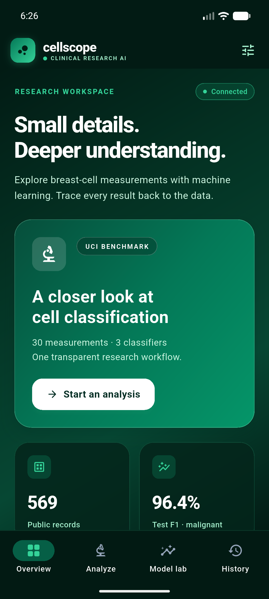
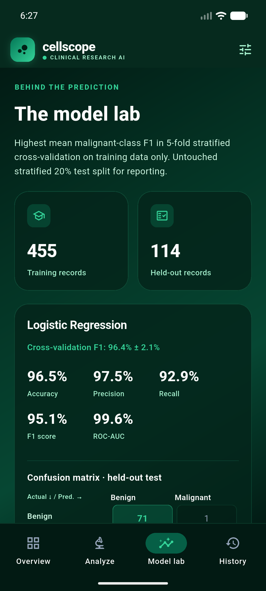
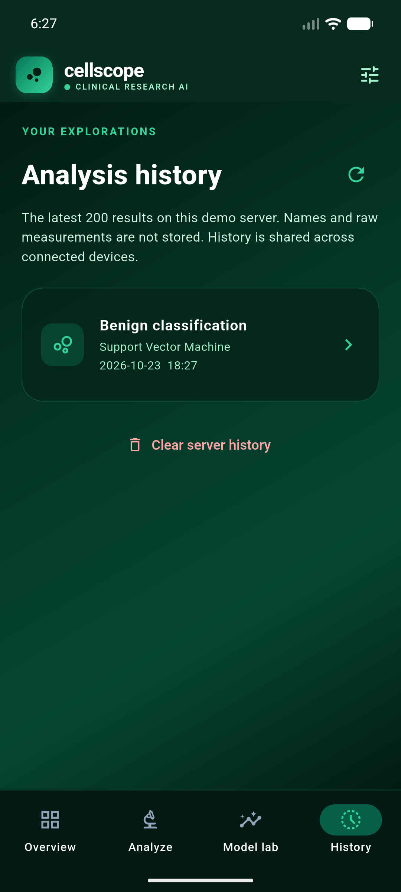
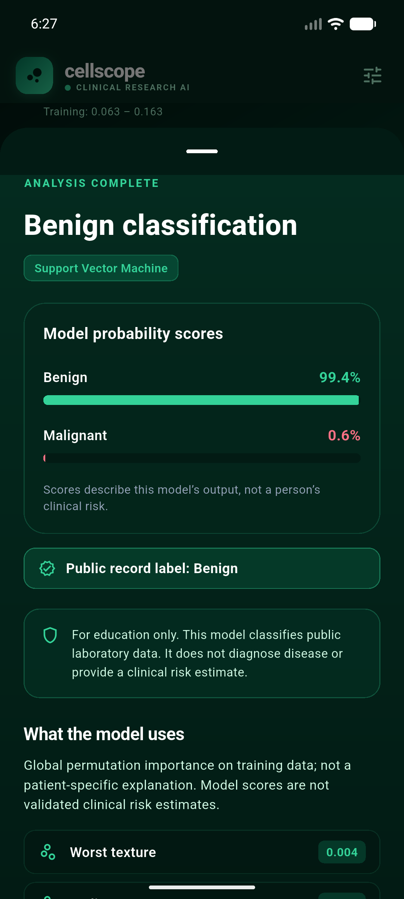
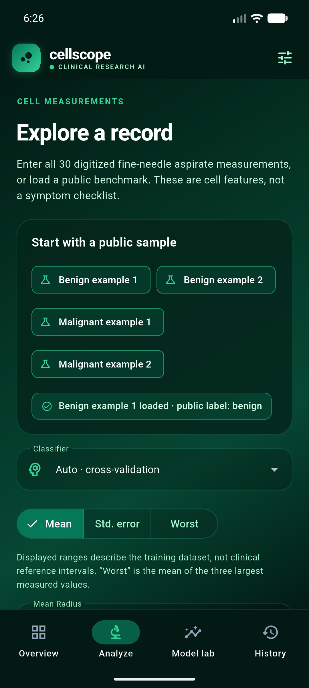

# Disease Prediction from Medical Data

 

A **modern machine‑learning pipeline** that predicts disease risk from heterogeneous medical data (clinical records, lab results, imaging metadata). The project ships as a Docker‑Compose stack with a **backend‑gateway**, **ML service**, and a **frontend UI**.

---

## Table of Contents

- [Project Overview](#project-overview)
- [Architecture](#architecture)
- [Setup & Installation](#setup--installation)
- [Running the Services](#running-the-services)
- [API Usage](#api-usage)
- [Screenshots](#screenshots)
- [Contributing](#contributing)
- [License](#license)

---

## Project Overview

The pipeline ingests CSV/JSON patient records, performs feature engineering, trains a gradient‑boosting model, and exposes a REST API for inference. The UI visualises patient risk scores and model explanations.

## Architecture

```
frontend  <--->  backend-gateway  <--->  ml-service
               ^                ^
               |                |
            Docker-Compose     Docker-Compose
```

- **frontend** – React app for visualising predictions.
- **backend‑gateway** – FastAPI service handling authentication, request validation, and routing.
- **ml‑service** – PyTorch/Scikit‑Learn model serving layer.

---

## Setup & Installation

```bash
# Clone the repo
git clone <repo‑url>
cd CodeAlpha_Disease_Prediction_From_Medical_Data

# Create a virtual environment (optional but recommended)
python -m venv venv
source venv/Scripts/activate   # Windows PowerShell

# Install Python dependencies
pip install -r requirements.txt

# Bring up Docker containers
docker-compose up -d
```

> **Note**: Ensure Docker Desktop is running and the `docker-compose.yml` file is present.

---

## Running the Services

```bash
# Start the stack (detached)
docker-compose up -d

# View logs
docker-compose logs -f
```

The API will be available at **`http://localhost:8000`** and the UI at **`http://localhost:3000`**.

---

## API Usage

```bash
# Example: Get model prediction
curl -X POST http://localhost:8000/predict \
    -H "Content-Type: application/json" \
    -d '{"patient_id": "12345", "features": {...}}'
```

Refer to the Swagger UI at **`http://localhost:8000/docs`** for full documentation.

---

## Screenshots

| Overview | Model Lab | History |
|:--------:|:--------:|:-------:|
|  |  |  |
| **Result** | **Analysis** |
|  |  |

*Click any image to view the full‑size screenshot.*

---


## License

Distributed under the MIT License. See `LICENSE` for more information.
